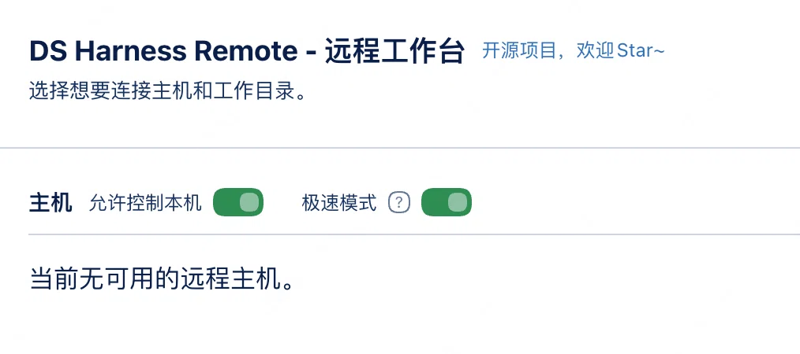

<p align="center">

  
</p>

<p align="center">
  <strong>DS Harness Remote · 极速分支（fork）</strong>
</p>

<p align="center">
  <a href="https://github.com/liguobao/ds-harness-remote">上游仓库</a>
  &nbsp;·&nbsp;
  <a href="https://github.com/liguobao/ds-harness-remote/issues/299">上游 issue #299</a>
  &nbsp;·&nbsp;
  <a href="docs/README.md">文档</a>
  &nbsp;·&nbsp;
  <a href="https://dsh.r2049.cn/app">Web</a>
</p>

---

## 这个 fork 是什么

上游 [liguobao/ds-harness-remote](https://github.com/liguobao/ds-harness-remote) 的**速度优化分支**，只加一件事：
**尽量少地往远端塞数据**，让连接更快、更稳，尤其是大会话（几百条记录 + 插件投影）在弱网/中继下的首屏。

除「极速模式」外，本分支与 `upstream/main` 完全一致，跟随上游 rebase。

## 为什么单独 fork

远端首屏的整条历史快照必须塞进一条 secure 消息（`MAX_SECURE_MESSAGE_BYTES` = 4 MB）。会话一大就超限，Host 直接抛 `Oversized Harness Remote frame` 并断开——上游 issue [#299](https://github.com/liguobao/ds-harness-remote/issues/299)。

同一个会话里真正占体积的往往不是聊天正文，而是**插件投影**（`dsh-context-lens` 这类面板动辄 1–2 MB）和**几百条历史记录**，这些信息在远端大部分时候没必要传。

我们把修复做成了 Host 端开关（[PR #311](https://github.com/liguobao/ds-harness-remote/pull/311)）。上游的取向是「Host 端开关越少越好，投影强度应该由发起方在协议里约定」——方向我们认同，但当下有几个**改不了的发起方**：

- **Remote Web**（`dsh.r2049.cn`）是独立闭源前端
- **iOS** 还在 TestFlight，未公开
- **DSH Go** 是第三方 App（它内置本插件，但不会为这个功能单独加 UI）

在它们支持新参数之前，Host 端兜底是唯一能让大会话不断连的手段。所以 PR 先关掉，fork 自己维护；等上游真的落地 per-connection 参数（`projection / maxRecords / maxBytes`），这个开关会退化成「默认值」，那时再回归官方包。

## 极速模式实测（2026-11-06）

同一台 Host、同一部手机（DSH Go，`transferFrames: true`），把两个图片较多的会话各打开一次、历史各上滑两次，只在 **≥256 KB 的帧**上打点（小帧不值得记录，所以"0 条"就是"没有超过 256 KB 的帧"）：

| 场景 | ≥256 KB 的帧 | 峰值帧 | 明细 |
| --- | ---: | ---: | --- |
| 极速模式 **关** | 4 条，合计 3,284,911 B | **1,439,894 B** | snapshot 1,262,357 / 1,439,894 B；baseline 291,330 B ×2 |
| 极速模式 **开** | **0 条** | **< 262,144 B** | 两个会话连一条 ≥256 KB 的帧都没有产生 |

也就是说，这两个会话首屏最大的那一帧从 **1.44 MB 降到 256 KB 以内（−82% 以上）**，而且不再有 291 KB 的 baseline 投影帧。

**为什么降这么多**：省下来的几乎全是**记录条数**（整页 393 条 → 10 条）。工具详情压缩本身只占 1–4%；插件投影（`dsh-context-lens` 这类）在 baseline 里通常是大头，被「单项 16 KB 上限 / 单帧 256 KB 总量预算」挡掉。

**它不省什么**：对话过程中的增量帧、心跳/信令、Host 侧的 CPU 与磁盘（快照照旧生成，只在出站前裁剪）。

## 强制缩略图（默认关闭）

远端客户端读图走 `session/attachment`（历史里只有 `ImageAttachmentRef` 引用，没有图片字节），所以缩略图就是在这个响应上做：

- 只有原图 **> 256 KB** 才处理（分级阈值，小图和表情包原样给）
- 统一重编码为 JPEG：最长边 **1024px**、质量 **75**；用 `sharp`（若已安装）→ macOS `sips` → Linux `convert`/`magick` → 纯 JS PNG，全部失败就原样转发
- 按 `attachmentId`（内容哈希）缓存，同一张图只转一次；并发上限 2
- 返回时 **`attachment` 引用原样保留**（`bytes/width/height` 不变）——客户端会用记录里的元数据校验返回值，改了就会被判"图片不可用"
- 代价：**点开大图看到的也是这张缩略图**，细节会丢；所以默认关闭，由用户显式开启

开关在 Remote 弹窗里（「极速模式」右边），也可以在对话里让 Host 打开或关掉——插件注册了 agent 工具 `remote_thumbnail_mode`，切换会持久化到配置。

## 与主分支的区别

| | 上游 `main` | 本分支 `lite` |
| --- | --- | --- |
| 极速模式 | 无 | **默认开启**，可在 Remote 弹窗或插件设置里手动关闭 |
| 首屏历史 | 全量 | 只发最近 **10 条**（`hasMore: true`，可往回翻） |
| 工具详情 | 原样 | 长文本压缩（单条 ≤512 字符，工具 input/output 折叠） |
| 插件投影 | 全量 | 单个 >16 KB 丢弃；单帧总量 ≤256 KB；渲染必需的投影（标题、模型、权限、会话列表元数据、图片限制）始终保留 |
| 单帧超限 | 直接断连（web） | 先裁剪；裁剪后仍超限才断 |
| 存储 / agent 上下文 | — | **完全不动**，只影响出站数据 |
| 其它协议 / 客户端 | — | 与上游一致，不新增协议字段 |

<p align="center">
  
</p>

上图：Remote 弹窗里 **极速模式** 就排在「允许控制本机」后面，**默认打开**；点右边的开关即可关闭（关闭后远端拿到完整历史，大体积会话可能重新触发断连）。

## 装到本机

本仓库**提交了构建产物**（`packages/plugin/dist/index.js`、`client.github.js`），所以不必自己装依赖也能跑；要从源码构建：

```bash
git clone https://github.com/rainow/ds-harness-remote-fast
cd ds-harness-remote-fast
pnpm install --frozen-lockfile
pnpm --filter './packages/**' -r build      # protocol → crypto → webrtc → client-core → plugin
```

然后把两个 bundle 覆盖到已安装的插件里（路径以你的 profile 为准，本文用 `web`）：

```bash
DEST=~/.dsh/profiles/web/node_modules/ds-harness-remote/dist
cp packages/plugin/dist/index.js packages/plugin/dist/client.js "$DEST"/
launchctl kickstart -k gui/$(id -u)/com.dsh.web   # 重启 dsh web
```

> `client.js` 换文件即时生效，`index.js` 需要重启 dsh 才生效。
> 注意：**profile 里任何一次 `pnpm install` / 装别的插件都会把 `dist/` 还原成 npm 上的官方版本**（0.6.2，不含极速模式），届时 GUI 会显示「Remote 插件控制通道仍在启动」，因为官方 schema 不认识 `liteMode` 这个键。重新覆盖一遍即可。

配置项只有一个：

| 配置 | 默认 | 说明 |
| --- | --- | --- |
| `liteMode` | `true` | 极速模式。`false` 时行为与上游完全一致；切换立即生效，无需重启 |

## 它能省多少

同一个大会话（8.7 MB 上下文）实测：

| | 首屏最大帧 | snapshot 体积 |
| --- | --- | --- |
| 极速模式关 | 2,070,505 B / 393 条记录 | baseline 投影 1,007,578 B |
| 极速模式开 | 无 >256 KB 的帧 | 同上基线，出站前裁剪 |

客户端落在 `Relay` / `TURN` 时，这些字节是真的从服务器转发的，所以对自建服务器的带宽和转发缓冲同样有效；P2P 直连时只影响客户端解码与内存。

**它不省什么**：持续对话产生的增量帧、心跳/信令、Host 侧的 CPU/内存与磁盘（快照照旧生成，只是出站前裁剪）。

## 还能继续优化的方向

按收益从大到小，目前**没做**（做了就会改动协议或客户端，超出本 fork 的范围）：

- **web 端声明 `transferFrames`**：声明后大帧可以分块传输，4 MB 上限就不再是死线（要改闭源 web 客户端）
- **接上压缩再加密**：帧在加密前 gzip，密文体积降一个量级（要改协议，两端都得升）
- **减少连接建立阶段的往返**：`transport.describe` / 状态流目前是若干次小请求，可合并
- **图片与附件**：现在只保留大小限制元数据，正文里的大图仍按原样参与投影

如果你有别的体积大头（某个插件投影特别大），在 issue 里贴一下 `lite off` 时的帧大小，比对着加 keep-list 更靠谱。

## 跟随上游

```bash
git remote add upstream https://github.com/liguobao/ds-harness-remote.git
git fetch upstream main
git rebase upstream/main      # dist 冲突时：重新 build 后再 git add packages/plugin/dist
```

`dist/` 是构建产物，每次 rebase 后都要按上面的命令重新生成并提交（上游 CI 也校验这一点）。

## 许可与致谢

代码来自 [liguobao/ds-harness-remote](https://github.com/liguobao/ds-harness-remote)，遵循其原许可。本分支只改「极速模式」相关逻辑，问题请先看上游 issue；确实与极速模式有关再来这边提。

## npm

```bash
dsh plugin --profile web add ds-harness-remote-fast
```

包名 `ds-harness-remote-fast`（不是上游的 `ds-harness-remote`），所以可以和上游插件并存安装、互不覆盖；`cordis.patch.yml` 里的 entry id 仍是 `ds-harness-remote`，你已有的 `liteMode` 等配置不会丢。
本仓库刻意不带 `dsh-plugin` 关键词，因此**不会出现在插件市场**里，也就不会被市场更新覆盖。
