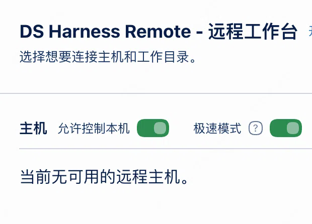

# ds-harness-remote-fast

**DeepSeek Harness Remote 的极速分支（fork）** —— 只做一件事：**尽量少地往远端发数据**，让大会话的远程连接不再因为帧超限而断掉，也更快。

> 上游项目：[liguobao/ds-harness-remote](https://github.com/liguobao/ds-harness-remote)
> 本 fork：[rainow/ds-harness-remote-fast](https://github.com/rainow/ds-harness-remote-fast)（`lite` 分支）
> 与本 fork 同步的完整说明：[README](https://github.com/rainow/ds-harness-remote-fast/blob/lite/README.md)

## 为什么有这个包

远端首屏的整条历史快照必须塞进一条 secure 消息（4 MB 上限）。大会话一超限，Host 就抛 `Oversized Harness Remote frame` 并断开（上游 issue [#299](https://github.com/liguobao/ds-harness-remote/issues/299)）。真正占体积的往往不是聊天正文，而是插件投影（`dsh-context-lens` 这类面板动辄 1–2 MB）和几百条历史记录。

修复曾以 [PR #311](https://github.com/liguobao/ds-harness-remote/pull/311) 提交给上游；上游的取向是「Host 端开关越少越好、投影强度由发起方在协议里约定」。方向没问题，但 Remote Web、iOS（TestFlight）、DSH Go 这些发起方改不了或改得慢，在它们支持新参数之前，Host 端兜底是唯一能让大会话不断连的手段。所以以独立包名发布、自己维护。

## 极速模式（默认开启）



在 Remote 弹窗里就排在「允许控制本机」后面，**默认打开**；也可以在插件设置里关掉。关闭后行为与上游完全一致。

远端还能用自然语言让 host 改：插件注册了 agent 工具 `remote_fast_mode`，在对话里说「打开 ds-harness-remote-fast 插件的极速模式开关」即可。

开启后：

- 首屏历史只发最近 **10 条**（`hasMore: true`，可往回翻）
- **工具详情压缩**：单条长文本 ≤512 字符，工具 input/output 折叠
- **投影预算**：单个投影 >16 KB 丢弃，单帧投影总量 ≤256 KB；标题 / 模型 / 权限 / 会话列表元数据 / 图片限制始终保留
- 单帧超限时**先裁剪再发送**，而不是直接断连
- 存储与 agent 上下文完全不动，只影响出站数据；协议与客户端未改

同一台 Host、同一部手机（DSH Go，`transferFrames: true`）实测两个图片较多的会话：极速模式**关闭**时首屏有 **4 条 ≥256 KB 的帧（峰值 1.44 MB）**，**开启**后**一条都没有**（全部 <256 KB）。逐帧明细见[仓库 README](https://github.com/rainow/ds-harness-remote-fast/blob/lite/README.md)。

## 安装

```bash
dsh plugin --profile web add ds-harness-remote-fast
```

- 包名是 `ds-harness-remote-fast`（上游占用 `ds-harness-remote`），安装不会覆盖上游的 npm 包；同一 profile 里只启用其中一个
- `cordis.patch.yml` 里的 entry id 仍是 `ds-harness-remote`，已有配置（`liteMode` / `serverUrl` / `role` …）迁移后不丢
- 本包**不带 `dsh-plugin` 关键词**，因此不会出现在插件市场里，也不会被市场更新覆盖（这是刻意的：市场只会拉到上游版本）

配置项只有一个：

| 配置 | 默认 | 说明 |
| --- | --- | --- |
| `liteMode` | `true` | 极速模式；`false` 时与上游行为完全一致，切换立即生效 |

## 与上游的差异

除极速模式相关逻辑和一处后端探测的性能修正（同步 `which` 改为异步 `execFile` + 30 秒 TTL 缓存）外，本包与 `upstream/main` 保持一致，跟随上游 rebase。协议、客户端行为、数据面均未改变。

## 反馈

与极速模式相关的问题请提到 [本 fork 的 issues](https://github.com/rainow/ds-harness-remote-fast/issues)；与协议层、其它客户端相关的问题请提到上游。
